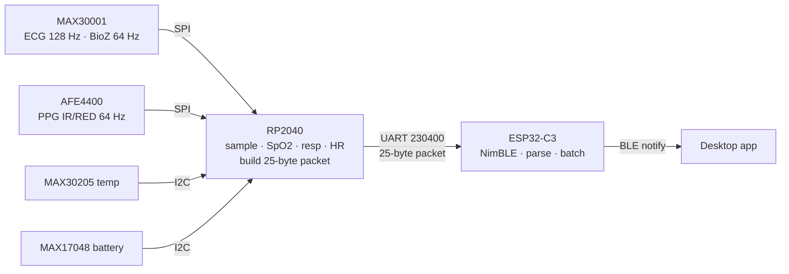

# NirogScan BareMetal

Bare-metal firmware for the NirogScan wearable. Two MCUs, no Arduino HAL:

- **`rp2040/`** — sensor node (pico-sdk). Reads MAX30001 (ECG + BioZ), AFE4400
  (PPG), MAX30205 (temperature) and MAX17048 (battery), computes SpO2 /
  respiration / heart rate, and streams a 25-byte packet over UART.
- **`esp32c3/`** — BLE gateway (ESP-IDF + NimBLE). Parses the packet and
  re-publishes each signal as a GATT notification for the desktop app.

Sensor register configuration mirrors the ProtoCentral / Zephyr reference so
the sensors behave exactly as intended.

## Data flow



## Packet structure (25-byte payload)

Framing: header `0A FA 19 00 02` + 25 data bytes + footer `00 0B` (`0x19` = 25 = length).

| Bytes | Field | Type |
|-------|-------|------|
| 0–3   | ECG | int32 LE |
| 4–7   | BioZ | int32 LE |
| 8     | BioZ valid | `0x00` fresh / `0xFF` skip |
| 9–12  | PPG IR | int32 LE |
| 13–16 | PPG RED | int32 LE |
| 17–18 | Temperature ×100 | uint16 LE |
| 19    | SpO2 % | uint8 |
| 20    | Battery % | uint8 |
| 21–22 | Heart rate (bpm) | uint16 LE |
| 23–24 | Respiration rate | uint16 LE |

## BLE characteristics (what the app subscribes to)

| Signal | UUID | Notification payload |
|--------|------|----------------------|
| ECG | `00001424-0000-1000-8000-00805f9b34fb` | int32 LE array (4 samples/notify) |
| Resp (BioZ) | `babe4a4c-7789-11ed-a1eb-0242ac120002` | int32 LE array (valid only) |
| PPG | `cd5c1525-4448-7db8-ae4c-d1da8cba36d0` | int16 LE (IR>>8), ~64 Hz |
| Resp rate | `cd5ca86f-4448-7db8-ae4c-d1da8cba36d0` | uint16 LE |
| Heart rate | `0x2A37` | `[flags, hr]` / `[flags, lo, hi]` |
| SpO2 | `0x2A5E` | `[0, spo2, 0]` |
| Temperature | `0x2A6E` | uint16 LE (×100) |
| Battery | `0x2A19` | uint8 |

Waveforms are batched into one notification each to keep the BLE link smooth;
vitals are rate-limited (1 s, battery 5 s). Advertises as `HealthyPi5`.

## Build

Both are PlatformIO projects.

```bash
cd rp2040   && pio run -t upload     # RP2040 (Earle Philhower core + pico-sdk)
cd esp32c3  && pio run -t upload     # ESP32-C3 (ESP-IDF + NimBLE)
```

Wiring between the boards: **RP2040 GP24 (TX) → ESP32-C3 GP7 (RX)**, common ground.
